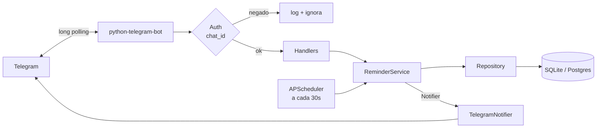
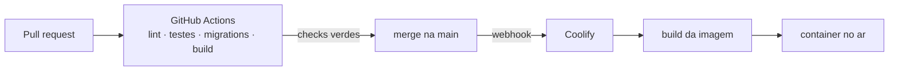

# 🤖 Telegram Assistant

[](https://github.com/ViniciuPSantos/TelegramBot/actions/workflows/ci.yml)

Assistente pessoal no Telegram, construído como um **hub de módulos**: cada funcionalidade (lembretes, monitor de preços, resumo diário...) é um módulo independente que se pluga no bot.

> Projeto pessoal de estudo de Python moderno (async, SQLAlchemy 2.0, type hints), com foco em arquitetura limpa, testes e deploy com Docker.

## ✨ Funcionalidades

**Fase 1: Lembretes** ✅

| Comando | O que faz |
|---|---|
| `/lembrete <data> [hora] <texto> [--antes N]` | Cria um lembrete. Aceita `15/11`, `15/11 14:30`, `hoje 18:00`, `amanha 10:00`. Sem hora, vale 09:00. `--antes N` envia um aviso extra N dias antes |
| `/lembretes` | Lista os pendentes, com botões **✅ Concluir** e **🗑 Apagar** |
| `/concluidos` | Mostra os 10 últimos concluídos |

- No horário, o bot envia o aviso com os botões **✅ Feito** e **⏰ Adiar 1h**
- Lembretes que vencem com o bot desligado são enviados assim que ele volta, marcados como **⚠️ Atrasado**

**Fase 2: Monitor de preços** 🚧

| Comando | O que faz |
|---|---|
| `/monitorar <link> [alvo]` | Começa a monitorar um produto. O alvo é opcional e aceita `1.149,90`, `1149.90`, `1149` ou `R$ 1.149,90` |
| `/produtos` | Lista os monitorados com preço atual, menor preço já visto e alvo, com botões **🗑** para parar |

- **Com alvo:** avisa quando o preço chega no alvo (uma vez; se subir de novo, rearma)
- **Sem alvo:** avisa quando o preço cai 1% ou mais
- Também avisa quando o produto **volta ao estoque**, e se a página parar de ser lida ou a loja começar a recusar as consultas
- Lojas suportadas: **Kabum** (Amazon e Mercado Livre em breve)

**Geral**

- **Bot privado:** só responde ao `chat_id` configurado; qualquer outro usuário é ignorado e a tentativa é registrada no log

## 🏗 Arquitetura



**Decisões principais:**

- **O banco é a fonte de verdade.** Em vez de agendar um job por lembrete, um único job consulta o banco a cada 30s e envia o que venceu. Assim nada se perde se o bot reiniciar, e os lembretes atrasados são entregues na subida.
- **Camadas desacopladas.** O `ReminderService` não conhece o Telegram: ele recebe um `Notifier` (um `Protocol`) e trabalha só com UTC. Os handlers apenas traduzem entrada e saída, e as views são funções puras.
- **Módulos plugáveis.** Cada módulo expõe `register(app, ctx)` e recebe um `AppContext` com as dependências compartilhadas (settings, banco, scheduler). Adicionar um módulo novo é adicionar uma linha em `MODULES`.
- **UTC no banco, fuso só na borda.** Datas são gravadas em UTC (com um `TypeDecorator` que garante isso também no SQLite) e convertidas para `America/Sao_Paulo` apenas na exibição.
- **Entrega "pelo menos uma vez".** O aviso só é marcado como enviado depois que o Telegram confirma o envio.
- **Consultas "educadas" às lojas.** Cada produto é verificado a cada 8h (±30min de variação), em lotes de 10 e com pausas de 3 a 8s entre as requisições. Se a loja responder 403, 429 ou 503, ela fica pausada por 6h. Nada de proxies nem de burlar captcha.
- **Proteção contra SSRF.** O bot só busca links de domínios permitidos e confere o domínio de novo depois dos redirecionamentos, porque o container divide a rede com outros serviços.
- **Dinheiro em centavos.** Preços são `int` em centavos no banco e nas regras; `Decimal` só na conversão do texto digitado. Nunca `float`.

## 🛠 Stack

Python 3.12+ · [uv](https://docs.astral.sh/uv/) · python-telegram-bot 21+ · APScheduler · SQLAlchemy 2.0 (async) · Alembic · pydantic-settings · httpx · pytest + pytest-asyncio · ruff · Docker

## 🚀 Como rodar

### 1. Crie o bot no Telegram

1. Abra o [@BotFather](https://t.me/BotFather) e envie `/newbot`
2. Escolha um nome e um username (precisa terminar em `bot`)
3. Copie o **token** que ele envia (formato `123456789:AAH...`)
4. Descubra o seu **chat_id** enviando qualquer mensagem para o [@userinfobot](https://t.me/userinfobot)

> ⚠️ O token dá controle total do bot. Nunca o coloque em código ou commit. Se vazar, gere outro com `/revoke` no BotFather.

### 2. Configure

```bash
cp .env.example .env
```
Preencha `TELEGRAM_BOT_TOKEN` e `ALLOWED_CHAT_ID` no `.env`.

### 3a. Rodar com Docker (recomendado)

```bash
docker compose up -d --build
docker compose logs -f
```
As migrations são aplicadas automaticamente na subida, e o banco fica no volume `bot-data`.

### 3b. Rodar localmente

Requer o [uv](https://docs.astral.sh/uv/getting-started/installation/).

```bash
uv sync
uv run alembic upgrade head
uv run assistant
```

## ☁️ Deploy

Em produção, o bot roda numa VPS com [Coolify](https://coolify.io), a partir do mesmo `Dockerfile`:



- A `main` é protegida: só recebe código via PR, com os checks do CI passando
- Cada merge dispara um deploy automático (GitHub App + webhook)
- O banco SQLite fica num volume persistente, e as migrations rodam a cada subida do container
- O token e as demais configurações sensíveis ficam só no Coolify, disponíveis apenas em runtime (nunca no build da imagem)
- O container não expõe portas (long polling) e tem limites de CPU e memória, para não competir com outros serviços da VPS

## ⚙️ Configuração

| Variável | Padrão | Descrição |
|---|---|---|
| `TELEGRAM_BOT_TOKEN` | *(obrigatória)* | Token do @BotFather |
| `ALLOWED_CHAT_ID` | *(obrigatória)* | Único chat_id que o bot atende |
| `DATABASE_URL` | `sqlite+aiosqlite:///./data/assistant.db` | URL do SQLAlchemy (async) |
| `TIMEZONE` | `America/Sao_Paulo` | Fuso para interpretar e exibir datas |
| `LOG_LEVEL` | `INFO` | `DEBUG`, `INFO`, `WARNING`, `ERROR` |
| `LOG_FORMAT` | `text` | `text` (dev) ou `json` (produção) |
| `REMINDER_DEFAULT_HOUR` | `9` | Hora usada quando o lembrete não informa horário |
| `REMINDER_POLL_SECONDS` | `30` | Intervalo do job que envia os avisos |
| `PRICE_POLL_MINUTES` | `10` | Intervalo do job que procura produtos com verificação vencida |

## 🧪 Testes e qualidade

```bash
uv run pytest -q          # testes
uv run ruff check .       # lint
uv run ruff format .      # formatação
```

Os testes cobrem o parser de datas, a leitura de valores em reais, o extrator de JSON-LD, as regras de aviso de preço, os services (com relógio, loja e notifier falsos, sobre um SQLite em memória), as views e a montagem da aplicação. Nenhum teste acessa a rede.

## 📁 Estrutura

```
src/assistant/
├── main.py              # composition root: monta e sobe o bot
├── config.py            # Settings (pydantic-settings)
├── logging_config.py    # logs em texto ou JSON
├── core/                # auth, erros, contexto compartilhado, formatação
├── db/                  # engine, Base, tipo UTCDateTime
└── modules/
    ├── reminders/       # parser, model, repository, service, handlers, views, jobs
    └── prices/          # lojas, JSON-LD, regras, model, repository, service, handlers, views, jobs
alembic/                 # migrations
tests/
```

## 🗺 Roadmap

- [x] **Fase 1: Lembretes:** criação, listagem, avisos com botões, aviso antecipado, entrega de atrasados
- [ ] **Fase 2: Monitor de preços:** ~~Kabum, alvo, queda e volta ao estoque~~ ✅ · Amazon · Mercado Livre
- [ ] **Fase 3: Resumo diário:** mensagem às 8h com os lembretes do dia e outras informações
- [ ] **Fase 4: RAG com PDFs:** enviar PDFs e fazer perguntas sobre o conteúdo

## 📄 Licença

[MIT](LICENSE)
